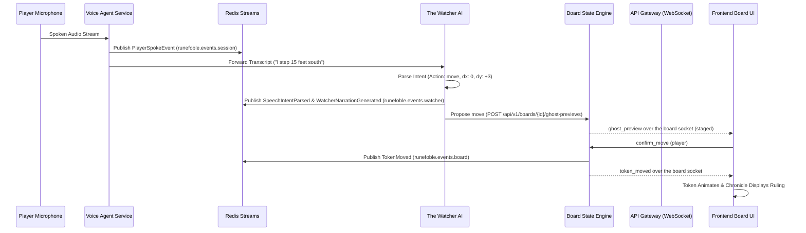
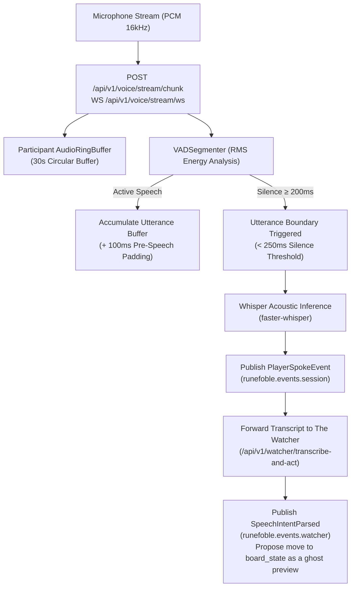

# Explanation: Realtime Voice and Tactical Board Synchronization

## Low Friction Storytelling: Speak and the Board Obeys

The goal of Runefoble is to provide the lowest friction tabletop experience in the world:
- Players should not spend game night looking down at coordinate spreadsheets or dragging tokens across screens.
- Players speak naturally: *"I charge three squares forward to intercept the skeleton."*
- The platform transcribes, extracts spatial intent, validates physics, animates the board, and updates the narrative chronicle in real time.

## Pipeline Architecture

## Intent Parsing Capabilities
The Watcher heuristic speech-to-intent engine delivers sub-10ms interpretation with fallback to LLM inference:
1. **Cardinal & Distance Movement**: Handles both distance-first ("step 15 feet south", "move 3 squares north", "advance 2 east", "retreat 1 west") and direction-first phrasing. Automatically scales feet to grid squares at 5 feet per square.
2. **Absolute Coordinates**: Directly maps coordinate targets like "move to 5, 8" into tactical grid positions clamped to board boundaries.
3. **Token Engagement & Flanking**: Recognizes tactical positioning commands like "move to the goblin archer" and "flank the skeleton".
4. **Combat Actions**: Identifies melee and ranged attacks ("attack goblin with longsword"), spell invocations ("cast fireball at 4, 6"), and skill checks ("stealth check").

## Streaming Audio Ingestion & VAD Segmentation Pipeline

To achieve true zero-friction interaction, Runefoble transitions from batch speech recording to continuous streaming audio ingestion:

### 1. Participant Ring Buffers (`AudioRingBuffer`)
Each active voice participant maintains an isolated, bounded circular ring buffer storing up to 30 seconds of 16-bit 16kHz mono PCM frames (960 kB). Audio frames are appended asynchronously without blocking real-time voice streaming or audio playback pipelines.

### 2. Sub-250ms Voice Activity Detection (`VADSegmenter`)
- **Subframe Energy Analysis**: Ingested PCM audio is segmented into 20ms analysis windows (320 samples / 640 bytes). Root-mean-square (RMS) amplitude is calculated to detect vocal phonemes against background acoustic silence.
- **Pre-Speech Buffering**: A 100ms circular pre-speech buffer ensures initial plosives and unvoiced consonants (e.g., /p/, /t/, /k/, /s/) are preserved when transitioning into speech.
- **Utterance Completion Detection**: When continuous silence exceeds 200ms (strictly within the < 250ms silence detection budget), the VAD marks the utterance boundary as completed, extracts the accumulated speech window, and hands off to acoustic inference.

### 3. Whisper Acoustic Inference & Event Dispatch
- **Acoustic Transcription**: The completed audio segment is transcribed via `FasterWhisperTranscriber` (CTranslate2 INT8 tiny.en/base.en model), the production default. The speech engine sits behind the `BaseTranscriber` port. There is no canned transcript in production. When the engine cannot load or infer, the chunk fails with `speech_engine_unavailable` and no `runefoble.events.watcher.player_spoke` is published. Tests inject a deterministic fixture engine at the composition root.
- **CloudEvent Publication**: An immutable `runefoble.events.watcher.player_spoke` is dispatched onto Redis Streams (`runefoble.events.session`).
- **Watcher Orchestration**: The transcript is concurrently delivered to `the_watcher` for spatial intent extraction and board action execution (`runefoble.events.watcher.speech_intent_parsed` and `runefoble.events.watcher.narration_generated`). For a move, The Watcher also proposes the move to `board_state` as a ghost preview. The Watcher never publishes `token_moved`. Only the player's `confirm_move` commits the move, and then `board_state` publishes `runefoble.events.board.token_moved`.

## WebRTC Voice Room Signaling Gateway Architecture

Bidirectional voice streams and audio mesh coordination are negotiated via the WebSocket at `/ws/voice/{session_id}`. The gateway relays that socket to `voice_agent` (TASK-0593), which owns the room state. In accordance with Hard Invariant 6 (File length limit < 500 lines) and ADR-0003 / ADR-0007, the signaling code lives in `voice_agent/signaling/`, split into single-responsibility modules:

- **Signaling Connection Manager (`voice_agent.signaling.manager`)**:
  `WebRTCSignalingManager` tracks active room WebSockets, peer lookups, disconnect cleanup, and directed or broadcast JSON frame transmission.
- **Session Socket Gate (`runefoble_auth.websocket`)**:
  `admit_websocket` with `action_authorizer("session.observe", session_id)` verifies the bearer, then checks `session.observe` on the room. A refusal closes the socket with `4403`. The voice routes use this same helper.
- **Signaling Peer Metadata (`voice_agent.signaling.auth`, `voice_agent.signaling.role`)**:
  `extract_peer_id` reads the presentation field `peer_id` from the query string. The user comes only from the verified bearer. The role comes only from the session permissions: `session.control` gives `dungeon_master`, `session.participate` gives `player`, and `session.observe` gives `spectator`. The `role` query parameter and the frame fields `user_id` and `role` never set identity or role. A `webrtc_join` frame that asks for another role gets an `error` frame with code `ROLE_MISMATCH`. The `from_peer` of a relayed offer, answer, or ICE candidate is always the sending socket's peer id.
- **Signaling Message Handlers (`voice_agent.signaling.handlers`)**:
  Dedicated dispatchers handle `webrtc_offer`, `webrtc_answer`, and `webrtc_ice_candidate` routing, `webrtc_mute` state toggles, `webrtc_telemetry` broadcasts, and graceful `webrtc_leave` teardowns.
- **WebSocket Endpoint (`voice_agent.signaling.endpoint`)**:
  `voice_signaling_websocket_endpoint` coordinates the connection lifecycle, sends initial `connected` and `webrtc_joined` frames, runs the dispatch loop, and handles unexpected disconnects.

## WebRTC Client Voice Service and Peer Connection Mesh Architecture

The browser voice controls live in the owning bounded context, `services/voice_agent/ui/src/` (`runefoble-voice-controls.ts`, `runefoble-voice-duplex-controls.ts`). The App Shell does not carry a separate WebRTC client. The former `frontend/src/services/webrtc-*.ts` and `webaudio-pipeline.ts` modules were unreachable from the App Shell and were removed in TASK-0824. The server side of the signaling path is described above.

## Campaign WebSocket Hub and Action Validator Gateway Architecture

Real-time campaign mutations, token movement broadcasts, health modifications, and Watcher notifications stream through `/ws/campaigns/{campaign_id}`. In accordance with Hard Invariant 6 (File length limit < 500 lines) and ADR-0001 / ADR-0007 / ADR-0009, the WebSocket infrastructure in `gateway_api` is partitioned into modular, single-responsibility submodules:

- **Zanzibar Action Validator (`gateway_api.websocket_validator`)**:
  `WebSocketActionValidator` executes fine-grained SpiceDB Zanzibar permission checks (`campaign:view`, `campaign:read`, `board_token:move`, `character:edit`, `dungeon_master`). It enforces DM bypass privileges, movement authorization, and blocks non-DM encounter mutations.
- **Connection Hub (`gateway_api.websocket_manager`)**:
  `ws_campaign_manager`, a `runefoble_platform.ws_groups.WebSocketGroups` keyed by campaign, tracks active client connections per campaign and broadcasts JSON to the connected party members. A socket whose send fails is pruned, and the other members still receive the message.
- **Credential & Handshake Auth (`gateway_api.websocket_auth`)**:
  `admit_gateway_websocket` binds the gateway verifier to the shared `runefoble_auth.websocket.admit_websocket` check. Every gateway socket route calls it before accept, and no route keeps its own admission code. The token comes only from the `runefoble.bearer.<jwt>` subprotocol. Query strings and headers carry no identity.
- **WebSocket Routing Endpoint (`gateway_api.websocket_endpoint`)**:
  `campaign_websocket_endpoint` runs the shared `runefoble_auth.websocket.serve_authorized_socket` loop, validates viewer connection permissions, dispatches incoming actions to Redis Streams (`runefoble.events.board`, `runefoble.events.session`, `runefoble.events.watcher`), and coordinates disconnect cleanup.

## Latency Budgets
- **Audio Capture & Streaming**: < 100ms
- **VAD Segmentation & Boundary Trigger**: < 200ms (< 250ms silence detection)
- **Speech-to-Text Transcription**: < 100ms (faster-whisper tiny.en)
- **Intent Parsing & Validation**: < 50ms (local heuristic < 5ms, remote LLM worker < 200ms)
- **Redis Stream Event Dispatch**: < 10ms
- **WebSocket Broadcast & Client Render**: < 40ms
- **Total End-to-End Voice-to-Board Latency**: < 500ms

This sub-500ms loop fulfills the foundational system promise: *Speak and the board obeys*.

