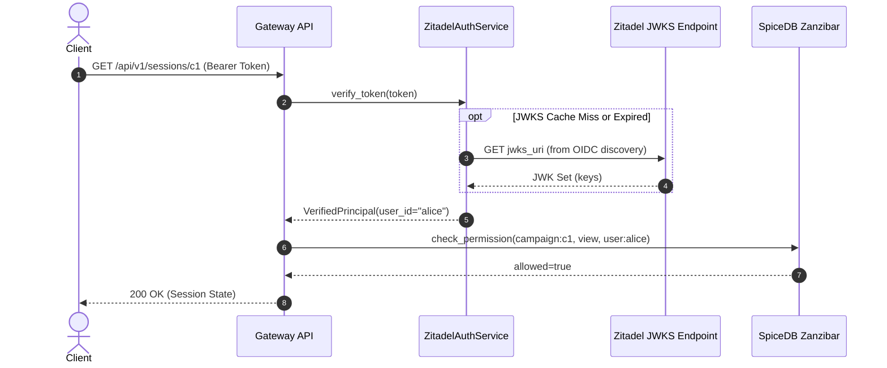

# How-To: Authenticate Users with Zitadel OIDC and JWTs

## Overview
Runefoble integrates with self-hosted Zitadel (`ghcr.io/zitadel/zitadel`) for OIDC sign-in. Zitadel issues RS256 access tokens. The `sub` claim is the user ID. The platform uses this ID as the Zanzibar `subject_id` in SpiceDB.

The platform has one identity verifier: `ZitadelAuthService` in `libs/runefoble_auth`. No mode disables verification. No header, query parameter, or request body sets identity. Roles and admin flags are not identity. Authorization comes from SpiceDB only (ADR-0001).

SpiceDB relations are written only for a verified principal. Token claims never write a relation. The claim sync route and its role mapping were removed (TASK-0534). Do not add code that writes relations from token claims.

The full identity contract for every surface is in [Identity and Token Contract](../reference/identity-and-token-contract.md). This guide shows how to use it.

## Architecture & Verification Flows

1. **User Login**: The frontend signs the user in with Zitadel (PKCE flow).
2. **Token Issuance**: Zitadel issues an RS256 access token with `sub`, `iss`, `aud`, `exp`, and optional `email` and `preferred_username`.
3. **Verification**: `ZitadelAuthService.verify_token` checks the RS256 signature against the issuer's JWKS. It checks `exp`, `sub`, `iss` (exact match), and `aud` (exact match). Any failure raises `TokenVerificationError`.
4. **Principal**: A passing token yields a `VerifiedPrincipal` (`user_id`, `username`, `email`).
5. **Zanzibar Check**: The `user_id` is the SpiceDB subject for permission checks.



---

## Step 1: Verify Tokens in `ZitadelAuthService`

```python
from runefoble_auth.principal import VerifiedPrincipal
from runefoble_auth.zitadel import ZitadelAuthService

auth_service = ZitadelAuthService(
    issuer="http://auth.localhost",  # Must equal the token `iss` claim
    audience="364509876543210987",  # Must equal the token `aud` claim (the project ID)
    internal_url=None,  # None: fetch discovery and JWKS from the issuer. Set it in a cluster.
    jwks_cache_ttl=300,  # Seconds
)

principal: VerifiedPrincipal = auth_service.verify_token(bearer_token)
```

Rules:
- `verify_token` accepts only `RS256`.
- Discovery and JWKS come from `<issuer>/.well-known/openid-configuration`. Zitadel does not serve keys at `/.well-known/jwks.json`.
- Settings: `RUNEFOBLE_ZITADEL_ISSUER`, `RUNEFOBLE_ZITADEL_AUDIENCE` (the project ID in a cluster), and `RUNEFOBLE_ZITADEL_INTERNAL_URL` (optional). The settings are read in `libs/runefoble_platform/src/runefoble_platform/config.py`.
- When `RUNEFOBLE_ZITADEL_AUDIENCE` is empty, the platform uses `RUNEFOBLE_ZITADEL_CLIENT_ID` (default `runefoble-api`) as the audience. A verifier built by hand with a blank audience raises `ConfigurationError` (`libs/runefoble_auth/src/runefoble_auth/zitadel.py`). Set the audience in every deployed environment.
- `RUNEFOBLE_ZITADEL_INTERNAL_URL` is the in-cluster origin, for example `http://zitadel:8080`. A pod cannot resolve the browser-facing host. When this setting is set, discovery and JWKS requests go to that origin with `Host` set to the issuer host. Zitadel refuses other hosts. The `iss` check still uses the issuer exactly.
- There is no offline or development bypass. Tests mint real signed tokens (Step 5).

---

## Step 2: Enforce Authentication in Gateway HTTP Endpoints

Use the shared dependency. Do not write a new one.

```python
from fastapi import APIRouter, Depends
from gateway_api.auth import CallerPrincipal, require_zanzibar_permission

router = APIRouter()


@router.get("/api/v1/profile")
async def get_profile(user: CallerPrincipal):
    return {"user_id": user.user_id, "username": user.username, "email": user.email}


@router.get(
    "/api/v1/sessions/{session_id}",
    dependencies=[Depends(require_zanzibar_permission("view", resource_type="campaign"))],
)
async def get_session(session_id: str):
    return {"id": session_id, "status": "active"}
```

A missing, malformed, or unverified Bearer token returns `HTTP 401` with `WWW-Authenticate: Bearer`. For the full contract, see [Verify Identity in FastAPI and WebSockets](verify-identity-in-fastapi-and-websockets.md).

The gateway does not read an `X-User-Id` header as identity. Use the verified token subject. The public routes are the health checks, the OpenAPI and docs pages, and the spectator and overlay reads. The reference lists each one and its code (see [Identity and Token Contract](../reference/identity-and-token-contract.md#4-public-routes)). Asset upload and delete routes take the owner from the token.

---

## Step 3: Authenticate Real-Time WebSocket Handshakes

Browsers cannot set `Authorization` on a WebSocket. The client offers two subprotocols:

1. `runefoble.v1` (the protocol name)
2. `runefoble.bearer.<jwt>` (the token)

The server reads the bearer subprotocol, verifies the token, and rejects the handshake before accept on failure. On success it accepts with `runefoble.v1`. Tokens in the URL query string are not accepted by the shared helper.

```python
from fastapi import WebSocket
from runefoble_auth.websocket import admit_websocket


async def campaign_websocket_endpoint(websocket: WebSocket, verifier) -> None:
    principal = await admit_websocket(websocket, verifier)
    if principal is None:
        return  # Refused with close code 1008 before accept
    # Verify SpiceDB permissions for principal.user_id before serving the session.
```

Every gateway WebSocket route calls `admit_websocket` before accept (TASK-0522). Tokens in the query string are refused.

After admission, each session socket checks a permission that `runefoble.zed` defines on the `session` object. `/ws/session/{id}`, `/ws/voice/{id}`, `/ws/mobile-companion/{id}`, `/ws/overlay/{id}`, and `/ws/spectator/{id}` need `session.observe`. The gateway closes a refused socket with code `4403`. It closes with `1011` when SpiceDB is unavailable. These checks use `runefoble_auth.websocket.action_authorizer("session.observe", session_id)` with `admit_websocket`.

On `/ws/campaigns/{id}`, an action name that the server does not define returns an `UNKNOWN_ACTION` error frame. The client never chooses a permission name.

---

## Step 4: Frontend Client Authentication

The App Shell uses the OIDC authorization-code flow with PKCE (ADR-0015 d). The App Shell never reads a password. Its code lives in `frontend/src/auth/`.

1. **Runtime settings.** The App Shell loads `/runtime-config.json`. It holds the issuer, client ID, scopes, and provider name. Helm renders the file. An init container fills in the client ID and the project ID from the Secret `runefoble-zitadel-client` when the pod starts. See [Bootstrap the Zitadel Project and Application](#bootstrap-the-zitadel-project-and-application).
   The scope list includes the project audience scope `urn:zitadel:iam:org:project:id:<projectId>:aud`. Zitadel then puts the project ID in the token `aud` claim.
2. **Sign-in.** `authService.startSignIn()` creates a `code_verifier`, its S256 `code_challenge`, a `state`, and a `nonce`. It keeps the verifier, state, and nonce in `sessionStorage`. It then sends the browser to the Zitadel authorize endpoint. Discovery at `<issuer>/.well-known/openid-configuration` supplies the endpoints. `Create Account` adds `prompt=create`, which opens the hosted sign-up page.
3. **Callback.** Zitadel redirects to `/auth/callback?code=...&state=...`. The App Shell checks `state` and the ID token `nonce`, exchanges the code with the verifier, and stores the tokens. It removes the code and state from the URL. Any error clears the session and shows the reason on the sign-in gate. A redirect URI cannot carry a fragment, so this callback is a real path, not a `#/` route.
4. **Renewal.** The App Shell renews the access token with the `refresh_token` grant. The scope list includes `offline_access`. A rejected refresh clears the session and returns the user to sign-in.
5. **Logout.** The App Shell clears local tokens and redirects to the Zitadel end-session endpoint with `id_token_hint`.

The App Shell sends the access token as `Authorization: Bearer`. The guard treats a token as present only while its own `exp` is in the future. Roles in the token are display data only. Permissions come from SpiceDB through the gateway (Hard Invariant 1).

---

## Bootstrap the Zitadel Project and Application

Zitadel generates the project ID and the client ID when it runs. The chart cannot know them at render time. The Helm hook Job `zitadel-bootstrap` creates them. It runs after `helm install` and `helm upgrade`. The chart template is `deployments/helm/runefoble/templates/zitadel-bootstrap.yaml`. The Job runs the `gateway-api` image and the module `runefoble_auth.zitadel_bootstrap_job`.

### What the Job does

1. Waits until Zitadel answers `GET /debug/healthz` (up to 5 minutes).
2. Finds the project `runefoble` or creates it (`zitadel.bootstrap.projectName`).
3. Finds the OIDC application `runefoble-web` or creates it (`zitadel.bootstrap.appName`). The application uses the authorization-code flow with PKCE, the `NONE` auth method (no client secret), and JWT access tokens. Its redirect URIs and post-logout URIs come from values.
4. Converges the redirect URIs and post-logout URIs of an existing application to the values. It changes nothing when they already match.
5. Server-side applies the Secret `runefoble-zitadel-client`. It has two keys: `project-id` and `client-id`.

A second run creates no project and no application. It writes the same Secret data.

### Admin token source

The Job calls the Zitadel management API with a personal access token (PAT). The chart delivers the PAT with no manual step:

1. Zitadel writes the PAT of the machine user to the file named by `ZITADEL_FIRSTINSTANCE_PATPATH` (`/zitadel/bootstrap/admin.pat`) on its first start. The file is on an `emptyDir` volume in the Zitadel pod.
2. The `pat-publisher` sidecar in the Zitadel pod waits for that file. It server-side applies the Secret `zitadel.bootstrap.adminSecret` (default `zitadel-admin`) with the key `pat`.
3. The Job reads the Secret when its container starts.

- Secret name: `zitadel.bootstrap.adminSecret` (default `zitadel-admin`).
- Key: `pat`.
- Owner: the `pat-publisher` sidecar. Do not create or edit this Secret by hand.
- Token owner: the machine user `zitadel.bootstrap.machineUsername` (default `runefoble-bootstrap`). Zitadel creates it on the first start with the `IAM_OWNER` role.
- RBAC: the `zitadel` Role can create Secrets in the namespace. It can get and patch only the Secret named by `zitadel.bootstrap.adminSecret`.

The sidecar reads the file only once per Zitadel database. A later pod restart does not write a new file. The Secret that the sidecar wrote stays valid while the Zitadel database stays.

### Local Kind install

Run `make helm-deploy` once. No separate PAT step is needed. The Job waits for Zitadel, so the first install takes several minutes. See [Tutorial 01](../tutorials/01-local-development-setup.md#step-4-validate-and-deploy-the-helm-chart) for the expected results.

If the Job starts while an older Secret still holds a token from a removed Zitadel database, the Zitadel call fails with HTTP 401. The Job then exits with an error. Kubernetes restarts the Job container. The restart reads the new token from the Secret.

```bash
# Check that the publisher wrote the Secret and that the Job finished.
kubectl get secret zitadel-admin -o jsonpath='{.data.pat}' | base64 -d | wc -c
kubectl get job zitadel-bootstrap
kubectl get secret runefoble-zitadel-client -o jsonpath='{.data.client-id}' | base64 -d; echo
```

Later upgrades run the Job again. It changes nothing when the project and application already match.

Until the Job finishes, the pods that read the Secret stay in `CreateContainerConfigError`. The services and the frontend start when the Secret exists. The services read `RUNEFOBLE_ZITADEL_AUDIENCE` from `project-id`. The App Shell reads `clientId` and the project audience scope from `client-id` and `project-id`.

### Production values

The values in `values.yaml` are for local Kind only. Before a shared deployment:

- Set `zitadel.externalDomain` to a real domain and `zitadel.externalSecure` to `true`. Set `zitadel.externalPort` to the public port. The issuer follows these values.
- Set `zitadel.bootstrap.devMode` to `false`. Use `https` redirect URIs and post-logout URIs.
- Set `zitadel.bootstrap.redirectUris` and `postLogoutRedirectUris` to the public App Shell origin.
- Set `zitadel.bootstrap.patExpirationDate` to a short date. Rotate the admin PAT.
- Set `credentials.existingSecret` (TASK-0626). Keep the admin PAT in your secret store.

---

## Step 5: Test with Signed Tokens

Tests use `SigningTestIssuer` from `runefoble_auth.testing.signing_test_issuer`. It creates an RSA key, mints RS256 tokens, and builds a verifier that trusts only that key.

```python
from runefoble_auth.testing.signing_test_issuer import SigningTestIssuer

issuer = SigningTestIssuer()
verifier = issuer.verifier()
token = issuer.mint("user-evelyn", username="evelyn")
```

Use `mint(..., expires_in=-60)`, `mint(..., audience="other")`, or `mint(..., issuer="http://evil.test")` for negative tests. Forge tokens with another key or with HS256 or `alg: none` to test rejection.

Shared fixtures are in `tests/helpers/zitadel_auth.py`. The `auth_environment` fixture configures the gateway with a signing verifier.

---

## Service-to-Service Credentials

A service that calls another service presents a service credential, not a user token (ADR-0015 e). The credential is a shared secret. It is stored in the `runefoble-credentials` Kubernetes Secret under key `service-credential` and read as `RUNEFOBLE_SERVICE_CREDENTIAL`.

The Zitadel machine-user client credentials flow is the alternative. This platform does not use it yet.

### Header and setting

| Setting | Header | Read by | Meaning |
|---|---|---|---|
| `RUNEFOBLE_SERVICE_CREDENTIAL` | `X-Runefoble-Service-Credential` | Senders: `gateway-api`, `gateway-mcp`, `the_watcher`, `game_session`, `campaign_lore`. Receivers: `board_state`, `character_sheet`, `game_session`, `rules_compendium`, `inference_worker`. | Shared credential. No default value. |

The header never carries a user token. `Authorization` stays the user token. The full sender and receiver list, with code paths, is in [Identity and Token Contract](../reference/identity-and-token-contract.md#2-surface-rules).

### Receiver rules

- A receiver accepts a verified user bearer or the service credential, on the routes that another service calls. The dependency is `runefoble_auth.caller.require_user_or_service_credential`, built through `get_caller_or_service`.
- A request with an `Authorization` header must verify as a Zitadel user token. A failed token gives `401`, even when the service credential is also present.
- A request with no `Authorization` header is a service call when it presents the credential. A service call has no user id. Routes that act for a user keep the user-only dependency, so a service call gets `401` there.
- The receiver compares the credential with `hmac.compare_digest`. Any other caller gets `401`.
- A receiver refuses to start when the setting is unset or blank (`libs/runefoble_platform/src/runefoble_platform/service_credential.py`, `expected_service_credential`).
- The MCP gateway sends the credential on owning-service calls (`gateway/mcp/src/gateway_mcp/owning_services.py`). It forwards the MCP caller's bearer when one exists.
- The API gateway sends the credential on calls to owning services (`gateway/api/src/gateway_api/upstreams.py`). No gateway route accepts it.
- The Watcher returns `503 backend_unavailable` and makes no worker call when the setting is unset (`services/the_watcher/src/the_watcher/worker_client.py`).
- A Zitadel user token is not a service credential. The inference worker returns `401` for it (`services/inference_worker/src/inference_worker/auth.py`).

### Helm

The chart renders the credential into the `runefoble-credentials` Secret for local environments. Other environments supply that Secret through `credentials.existingSecret`. The Secret must hold the key `service-credential`. Add the key to an existing Secret:

```bash
kubectl patch secret runefoble-credentials --type merge \
  -p "{\"stringData\": {\"service-credential\": \"$(openssl rand -hex 32)\"}}"
```

The `gateway-api`, `board-state`, `campaign-lore`, `character-sheet`, `game-session`, `rules-compendium`, `the-watcher`, `inference-worker`, and `gateway-mcp` deployments read the key as `RUNEFOBLE_SERVICE_CREDENTIAL` (`deployments/helm/runefoble/templates/services.yaml`, `gateway-mcp.yaml`, `inference-worker.yaml`).

### Test with a service credential

Set the same value in the test process and mint no user token for a service call. The root `tests/conftest.py` sets `RUNEFOBLE_SERVICE_CREDENTIAL=test-only-service-credential` before any settings load. Send the header from the test client:

```python
import os

from httpx import ASGITransport, AsyncClient
from inference_worker import api
from runefoble_platform.service_credential import SERVICE_CREDENTIAL_HEADER

headers = {SERVICE_CREDENTIAL_HEADER: os.environ["RUNEFOBLE_SERVICE_CREDENTIAL"]}
async with AsyncClient(
    transport=ASGITransport(app=api.app), base_url="http://test", headers=headers
) as ac:
    ...
```

## Verification & Blackbox Testing

- **Principal and HTTP dependency**: `libs/runefoble_auth/tests/test_verified_principal.py` covers accepted tokens and rejected tokens (missing, garbage, HS256, `alg: none`, unsigned, unknown key, expired, wrong `aud`, wrong `iss`, missing or empty `sub`) and the WebSocket handshake.
- **HTTP Bearer & JWKS (gateway)**: `tests/test_blackbox_zitadel_http_auth.py`.
- **WebSocket handshake (gateway)**: `tests/test_blackbox_zitadel_websocket_auth.py`.
- **Shared Auth Fixtures**: `tests/helpers/zitadel_auth.py`.
- **game_session, The Watcher, and inference worker identity**: `tests/test_blackbox_service_identity.py`.
- **Negative credential matrix (every surface)**: `tests/test_blackbox_identity_negative.py` sends each bad credential class to the gateway (HTTP and WebSocket), board_state, campaign_lore, rules_compendium, and voice_agent. Each case expects a refusal. Valid control tokens prove the trust setup is live. The retired sign-in, seed, and body-claim sync routes must be absent. The Gherkin mirror is `e2e/features/identity-negative.feature`.
