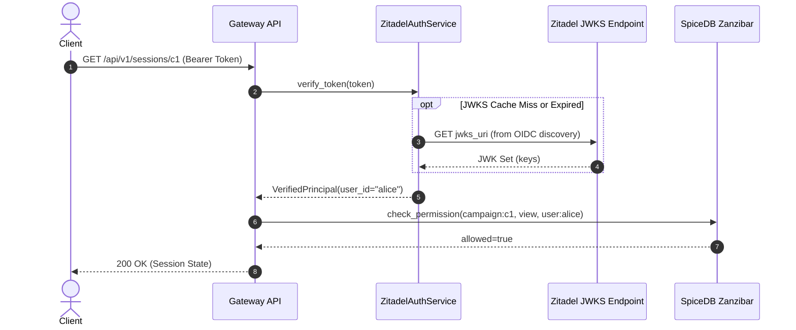

# How-To: Authenticate Users with Zitadel OIDC and JWTs

## Overview
Runefoble integrates with self-hosted Zitadel (`ghcr.io/zitadel/zitadel`) for OIDC sign-in. Zitadel issues RS256 access tokens. The `sub` claim is the user ID. The platform uses this ID as the Zanzibar `subject_id` in SpiceDB.

The platform has one identity verifier: `ZitadelAuthService` in `libs/runefoble_auth`. No mode disables verification. No header, query parameter, or request body sets identity. Roles and admin flags are not identity. Authorization comes from SpiceDB only (ADR-0001).

## Architecture & Verification Flows

1. **User Login**: The frontend signs the user in with Zitadel (PKCE flow).
2. **Token Issuance**: Zitadel issues an RS256 access token with `sub`, `iss`, `aud`, `exp`, and optional `email` and `preferred_username`.
3. **Verification**: `ZitadelAuthService.verify_token` checks the RS256 signature against the issuer's JWKS. It checks `exp`, `sub`, `iss` (exact match), and `aud` (exact match). Any failure raises `TokenVerificationError`.
4. **Principal**: A passing token yields a `VerifiedPrincipal` (`user_id`, `username`, `email`).
5. **Zanzibar Check**: The `user_id` is the SpiceDB subject for permission checks.



---

## Step 1: Verify Tokens in `ZitadelAuthService`

```python
from runefoble_auth.principal import VerifiedPrincipal
from runefoble_auth.zitadel import ZitadelAuthService

auth_service = ZitadelAuthService(
    issuer="http://zitadel:8080",   # Must equal the token `iss` claim
    audience="runefoble-api",       # Must equal the token `aud` claim
    jwks_url=None,                  # None: read jwks_uri from OIDC discovery
    jwks_cache_ttl=300,             # Seconds
)

principal: VerifiedPrincipal = auth_service.verify_token(bearer_token)
```

Rules:
- `verify_token` accepts only `RS256`.
- `jwks_url` defaults to the `jwks_uri` in `<issuer>/.well-known/openid-configuration`. Zitadel does not serve keys at `/.well-known/jwks.json`.
- Settings: `zitadel_issuer`, `zitadel_audience` (defaults to `zitadel_client_id`), and `zitadel_jwks_url` (optional internal URL for key fetch).
- There is no offline or development bypass. Tests mint real signed tokens (Step 5).

---

## Step 2: Enforce Authentication in Gateway HTTP Endpoints

Use the shared dependency. Do not write a new one.

```python
from typing import Annotated

from fastapi import APIRouter, Depends
from gateway_api.auth import get_current_user, require_zanzibar_permission
from runefoble_auth.principal import VerifiedPrincipal

router = APIRouter()


@router.get("/api/v1/profile")
async def get_profile(user: Annotated[VerifiedPrincipal, Depends(get_current_user)]):
    return {"user_id": user.user_id, "username": user.username, "email": user.email}


@router.get(
    "/api/v1/sessions/{session_id}",
    dependencies=[Depends(require_zanzibar_permission("view", resource_type="campaign"))],
)
async def get_session(session_id: str):
    return {"id": session_id, "status": "active"}
```

A missing, malformed, or unverified Bearer token returns `HTTP 401` with `WWW-Authenticate: Bearer`. For the full contract, see [Verify Identity in FastAPI and WebSockets](verify-identity-in-fastapi-and-websockets.md).

---

## Step 3: Authenticate Real-Time WebSocket Handshakes

Browsers cannot set `Authorization` on a WebSocket. The client offers two subprotocols:

1. `runefoble.v1` (the protocol name)
2. `runefoble.bearer.<jwt>` (the token)

The server reads the bearer subprotocol, verifies the token, and rejects the handshake before accept on failure. On success it accepts with `runefoble.v1`. Tokens in the URL query string are not accepted by the shared helper.

```python
from fastapi import WebSocket
from runefoble_auth.websocket import (
    RUNEFOBLE_SUBPROTOCOL,
    WebSocketAuthError,
    authenticate_websocket,
)


async def campaign_websocket_endpoint(websocket: WebSocket, verifier) -> None:
    try:
        principal = authenticate_websocket(websocket, verifier)
    except WebSocketAuthError:
        await websocket.close(code=4401)
        return
    await websocket.accept(subprotocol=RUNEFOBLE_SUBPROTOCOL)
    # Verify SpiceDB permissions for principal.user_id before serving the session.
```

> **Migration status:** The gateway WebSocket endpoint still reads the token from the query string and the `Authorization` header. It also accepts a `bearer.<jwt>` subprotocol with a different prefix. TASK-0522 moves the gateway to the shared helper above. Until then, do not add new WebSocket clients that depend on the query-string path.

---

## Step 4: Frontend Client Authentication

Browser sign-in and token handling are in `frontend/src/auth/`. The migration to Zitadel PKCE is tracked in TASK-0524. The frontend must not treat roles in the token as authority. Permissions come from the gateway.

---

## Step 5: Test with Signed Tokens

Tests use `SigningTestIssuer` from `runefoble_auth.testing.signing_test_issuer`. It creates an RSA key, mints RS256 tokens, and builds a verifier that trusts only that key.

```python
from runefoble_auth.testing.signing_test_issuer import SigningTestIssuer

issuer = SigningTestIssuer()
verifier = issuer.verifier()
token = issuer.mint("user-evelyn", username="evelyn")
```

Use `mint(..., expires_in=-60)`, `mint(..., audience="other")`, or `mint(..., issuer="http://evil.test")` for negative tests. Forge tokens with another key or with HS256 or `alg: none` to test rejection.

Shared fixtures are in `tests/helpers/zitadel_auth.py`. The `auth_environment` fixture configures the gateway with a signing verifier.

---

## Verification & Blackbox Testing

- **Principal and HTTP dependency**: `libs/runefoble_auth/tests/test_verified_principal.py` covers accepted tokens and rejected tokens (missing, garbage, HS256, `alg: none`, unsigned, unknown key, expired, wrong `aud`, wrong `iss`, missing or empty `sub`) and the WebSocket handshake.
- **HTTP Bearer & JWKS (gateway)**: `tests/test_blackbox_zitadel_http_auth.py`.
- **WebSocket handshake (gateway)**: `tests/test_blackbox_zitadel_websocket_auth.py`.
- **Shared Auth Fixtures**: `tests/helpers/zitadel_auth.py`.
