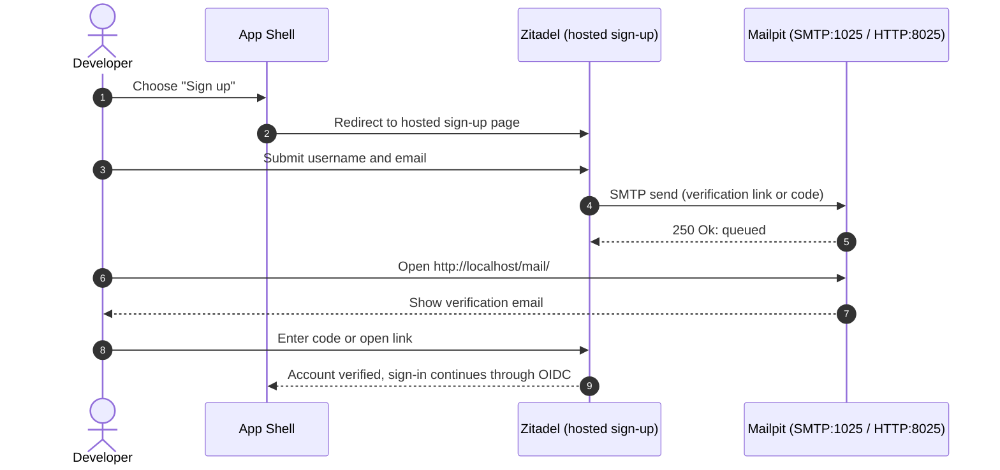

# How-To: Test Zitadel Sign-Up Email with Mailpit

## Overview

Runefoble uses **Mailpit** (`axllent/mailpit`) as the local mock SMTP server and email inbox. Zitadel sends all account email through Mailpit. Zitadel sends sign-up verification, password reset, and invitation email. The gateway sends no email and issues no tokens.

Mailpit provides:
1. **No external relay**: It captures every outgoing message in local storage.
2. **Web UI**: The inbox is at `http://localhost/mail/` or `http://runefoble.local/mail/`.
3. **REST API**: Tests read messages from the Mailpit API.

---

## Architecture

Zitadel is the only token issuer and the only identity provider (ADR-0005). New users sign up on the Zitadel hosted sign-up page. Zitadel sends the verification email through SMTP to `mailpit:1025`. Mailpit stores the message.



The Zitadel SMTP settings are in `deployments/helm/runefoble/templates/zitadel.yaml`. They point to `mailpit:1025` when `mailpit.enabled` is true.

---

## Step 1: Open the Mailpit Web UI

After `make cluster-up` and `make helm-deploy`, Traefik routes the Mailpit UI:

- **Ingress URL**: [http://localhost/mail/](http://localhost/mail/) or [http://runefoble.local/mail/](http://runefoble.local/mail/)
- **Internal cluster address**: `http://mailpit:8025`

The UI shows:
- The list of captured messages
- Plain text and rendered HTML views
- A link inspector for every link in a message

---

## Step 2: Sign Up Through Zitadel

1. Open the App Shell at `http://localhost/#/login`. Select **Create Account**. Zitadel opens its hosted sign-up page.
2. Enter a username, an email address, and a password on the Zitadel page.
3. Open Mailpit at `http://localhost/mail/`.
4. Open the newest message. Copy the verification code or open the verification link.
5. Complete verification on the Zitadel page.

The gateway has no sign-up route. Do not send sign-up requests to `/api/v1/auth/`.

---

## Step 3: Read Messages from the Mailpit API

Automated tests read messages through the Mailpit REST API. The `MailpitClient` class in `runefoble_platform` wraps this API.

```python
from runefoble_platform.email import MailpitClient

mailpit = MailpitClient()

# Clear the inbox before the test
await mailpit.delete_all_messages()

# Wait for the Zitadel message, then read it
latest = await mailpit.get_latest_message()
assert latest is not None
assert "evelyn@runefoble.local" in latest.to

code = MailpitClient.extract_verification_code(latest.text)
link = MailpitClient.extract_verification_link(latest.text)
```

Test setup must not write Zitadel state directly. Drive sign-up through the Zitadel frontdoor (ADR-0014). Use Mailpit only to read the result.

### Mailpit is down

`MailpitClient` has no in-memory fallback. When the SMTP server or the Mailpit HTTP API is unreachable, `send_email` and the read methods raise `EmailTransportError`. A failed purge also raises. Start Mailpit before you run tests that send or read mail. Use `await mailpit.check_health()` to see which service failed; its `http_error` and `smtp_error` fields give the cause.

---

## Step 4: Local Admin

The gateway no longer seeds administrators. The `make seed-admin` and `make invite-admin` targets and the invite admin script are removed. Local admin bootstrap is planned in TASK-0526.

---

## Related

- `docs/reference/ports-and-endpoints.md`: Mailpit ports and the gateway routes.
- `docs/how-to/authenticate-with-zitadel-oidc.md`: How the gateway verifies Zitadel tokens.
