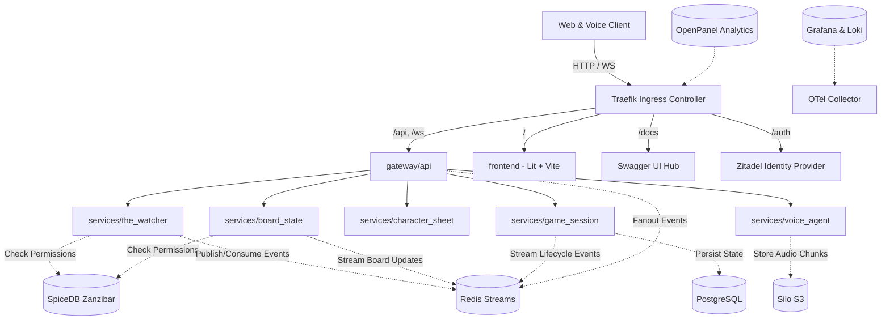

# Architecture Overview

## System Context Diagram

## Bounded Contexts

| Bounded Context | Path | Responsibilities |
|---|---|---|
| `runefoble_platform` | `libs/runefoble_platform` | Common configuration, base models, error hierarchy, event bus |
| `runefoble_auth` | `libs/runefoble_auth` | Zitadel JWT decoding, SpiceDB Zanzibar client & `runefoble.zed` schema |
| `runefoble_events` | `libs/runefoble_events` | CloudEvents-compliant event definitions for real-time storytelling |
| `the_watcher` | `services/the_watcher` | AI DM arbitration, speech-to-intent, stand-ins, and `@runefoble/the-watcher-ui` |
| `board_state` | `services/board_state` | Tactical grid, coordinates, movement, fog of war, and `@runefoble/board-state-ui` |
| `character_sheet` | `services/character_sheet` | Character stats, HP, penalties ("drunk"), and `@runefoble/character-sheet-ui` |
| `game_session` | `services/game_session` | Campaign lifecycle, invites, membership, and user profile. Session lobby, turns, combat, reactions, and spectator view. Campfire rests, stronghold, tavern games, and merchants. Settlement havens, establishments, NPC workers, haggling, and bulletin board. West Marches shared worlds, caravans, and bounties. `@runefoble/game-session-ui`. [ADR-0021](../project/adrs/proposed/adr-0021-game-session-internal-bounded-contexts.md) (Proposed) groups these domains into internal packages |
| `voice_agent` | `services/voice_agent` | Audio streaming, STT/TTS pipeline, and `@runefoble/voice-agent-ui` |
| `gateway_api` | `gateway/api` | API Gateway: authentication, routing to owners, WebSocket fan-out, and OpenAPI spec aggregation. It owns no domain state and imports no service package (see [Gateway route ownership](gateway-route-ownership.md)) |
| `gateway_mcp` | `gateway/mcp` | Model Context Protocol server exposing RPG tools to AI models |
| `frontend` | `frontend/` | Lightweight App Shell, global Bauhaus theme switcher, Storybook studio aggregator |

## Permission Checks at the Gateway

The gateway follows one rule for object permissions (TASK-0845, ADR-0001, ADR-0015):

- A **proxy route** verifies the bearer token and forwards it. The owning service checks the object permission. The gateway passes the owner's `403` through.
- A **composite route** combines several owner reads. The gateway checks the permission that the reply needs.

Proxy routes that keep a gateway check are listed in [Call Owning Services Through the Gateway](../how-to/call-owning-services-through-the-gateway.md#permission-rule).
