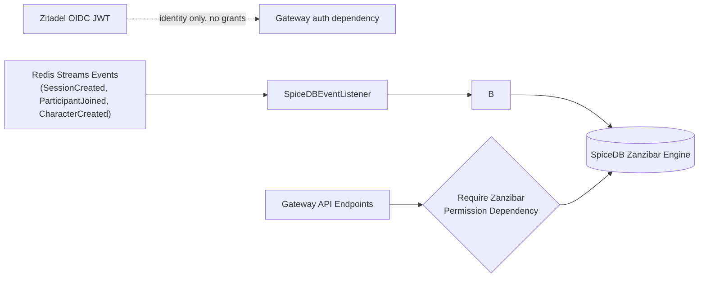

# Reference: SpiceDB Zanzibar Relationship Synchronization with Zitadel Identities

## Overview

Runefoble enforces object-level access control via Google Zanzibar schema on SpiceDB (`libs/runefoble_auth/schema/runefoble.zed`). The Zitadel-to-SpiceDB synchronization bridge translates domain events and authorized membership changes into Zanzibar relationship tuples. Zitadel identity claims never grant a relation. A token role such as `owner`, `dm`, or `is_admin` writes no tuple (ADR-0015 (d), TASK-0534).



## Zanzibar Schema Model (`runefoble.zed`)

This excerpt matches `runefoble.zed` for the definitions it shows. The schema file is canonical.

```zed
definition user {}

definition campaign {
    relation owner: user
    relation dungeon_master: user
    relation game_master: user
    relation player: user
    relation spectator: user

    permission manage = owner
    permission run_session = owner + dungeon_master + game_master
    permission play = run_session + player
    permission view = play + spectator
}

definition character {
    relation campaign: campaign
    relation owner: user

    permission edit = owner + campaign->run_session
    permission view = edit + campaign->view
    permission delete = owner
}

definition codex_entry {
    relation campaign: campaign
    relation author: user
    relation editor: user
    relation reader: user
    relation party_shared: campaign
    relation public: campaign

    permission view = author + editor + reader + party_shared->play + public->view
    permission edit = author + editor + campaign->run_session
    permission manage = author + campaign->run_session
}

definition game_session {
    relation campaign: campaign

    permission control = campaign->run_session
    permission participate = campaign->play
    permission observe = campaign->view
}

definition session {
    relation campaign: campaign

    permission control = campaign->run_session
    permission participate = campaign->play
    permission observe = campaign->view
}

definition board_token {
    relation campaign: campaign
    relation character: character

    permission move = character->edit + campaign->run_session
    permission inspect = campaign->view
}
```

## Relationship Tuples Mapped by ZitadelSync

| Trigger / Claim | SpiceDB Relationship Tuple | Meaning |
|---|---|---|
| Token claim (any role, `is_admin`) | None | Claims never write a tuple. The verified principal carries identity only. |
| Campaign role grant (`POST /api/v1/campaigns/{id}/roles`, requires `manage`) and invite redemption (`POST /api/v1/campaigns/join`) | `campaign:<id>#<role>@user:<sub_id>` | Grants the membership role after an authorized domain action |
| Character aggregate binding | `character:<char_id>#owner@user:<sub_id>`<br/>`character:<char_id>#campaign@campaign:<id>` | Binds character to owning player and campaign |
| Session aggregate binding | `session:<sess_id>#campaign@campaign:<id>` | Inherits campaign authorization policies onto the active session |
| Board token binding | `board_token:<token_id>#character@character:<char_id>`<br/>`board_token:<token_id>#campaign@campaign:<id>` | Enforces that only character owner or GM can move the token |

## Public Synchronization Endpoints

The gateway hosts one public sync endpoint under `/api/v1/auth/sync`: the health probe (section 4). The write routes were removed:

- `POST /user` was removed by TASK-0534.
- `POST /membership` was removed by TASK-0543. Campaign roles use `POST /api/v1/campaigns/{id}/roles` (requires `manage`). Membership comes from `POST /api/v1/campaigns/join`.
- `POST /character-ownership` was removed by TASK-0543. Ownership comes from character creation (`POST /api/v1/characters`).
- `POST /token-binding` was removed by TASK-0543. Token binding comes from the login frontdoor (TASK-0520).

Each removed route returns `404`.

### 1. `GET /api/v1/auth/sync/health`
Health probe reporting SpiceDB connectivity and synchronization backend (`mock` or `grpc`).

**Response (200 OK):**
```json
{
  "status": "healthy",
  "spicedb_connected": true,
  "sync_service": "operational",
  "backend": "mock"
}
```

## Domain Event Listeners

`SpiceDBEventListener` subscribes to domain events on Redis Streams or the local event bus:

- **`SessionCreated`**: Provisions `campaign:<id>#game_master@user:<dm_id>` and `session:<id>#campaign@campaign:<id>`.
- **`ParticipantJoined` / `PlayerJoinedSession`**: Provisions `campaign:<id>#<role>@user:<user_id>`. If `character_id` is present, also establishes character ownership.
- **`CharacterCreated`**: Provisions `character:<id>#owner@user:<player_id>` and `character:<id>#campaign@campaign:<id>`.
- **`TokenPlaced`**: Provisions `board_token:<id>#character@character:<character_id>` and `board_token:<id>#campaign@campaign:<id>`.

## Modular Architecture & Submodules

To adhere to Hard Invariant 6 (file length < 500 lines) and separate operational concerns, the Zanzibar synchronization service is decomposed into three focused submodules:

1. **Tuple Formatting & Operations (`sync_tuples.py`)**:
   - `SyncResult` model and `format_tuple` formatting utility.
   - `CAMPAIGN_ROLE_RELATIONS` mapping and `normalize_campaign_role` normalization tables.
   - `write_relationship_tuple` and `delete_relationship_tuple` with retry execution.
   - `batch_write_tuples` and `reconcile_tuples` idempotency helpers.

2. **Domain Event Handlers (`sync_events.py`)**:
   - `extract_event_type` and `get_event_field` parsing domain event models and CloudEvent JSON dictionaries.
   - `handle_domain_event` unified dispatcher routing `SessionCreated`, `ParticipantJoined`, `PlayerJoinedSession`, `CharacterCreated`, and `TokenPlaced`.
   - Granular event handlers (`handle_session_created`, `handle_participant_joined`, `handle_character_created`, `handle_token_placed`).

3. **Service Coordinator (`sync.py`)**:
   - `ZitadelSpiceDBSyncService` coordinator delegating to `sync_tuples` and `sync_events`.
   - Re-exports `SyncResult`. Claim-to-relation mapping does not exist (TASK-0534).

## Resilience & Retry Policy

`ZitadelSpiceDBSyncService` executes all SpiceDB writes and deletes with exponential backoff retry:
- Default `max_retries`: 3 attempts.
- Default base delay: 50ms with exponential scaling `retry_delay * 2^(attempt - 1)`.
- Automatic transparent fallback between live `authzed` gRPC connection and in-memory mock client ensures deterministic CI execution and local offline capability.
