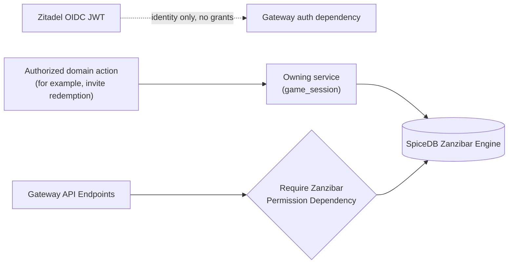

# Reference: SpiceDB Zanzibar Relationship Synchronization with Zitadel Identities

## Overview

Runefoble enforces object-level access control with the Zanzibar schema in SpiceDB (`libs/runefoble_auth/schema/runefoble.zed`). Zitadel identity claims never grant a relation. A token role such as `owner`, `dm`, or `is_admin` writes no tuple (ADR-0015 (d), TASK-0534). The full identity contract is in [Identity and Token Contract](identity-and-token-contract.md).

Relations are written in two ways:

- A domain service writes a tuple after an authorized action. For example, `game_session` writes the membership tuple when an invite is redeemed (`services/game_session/src/game_session/campaign/service_membership.py`).
- The sync library in `libs/runefoble_auth` holds handlers that build tuples from domain events. Its only production caller is the health probe. See [Production Callers](#production-callers).



## Zanzibar Schema Model (`runefoble.zed`)

The excerpt below copies `libs/runefoble_auth/schema/runefoble.zed` for these definitions. Comments are omitted. The schema file is canonical.

```zed
definition user {}

definition campaign {
    relation owner: user
    relation dungeon_master: user
    relation game_master: user
    relation player: user
    relation spectator: user

    permission manage = owner
    permission run_session = owner + dungeon_master + game_master
    permission play = run_session + player
    permission view = play + spectator
}

definition character {
    relation campaign: campaign
    relation owner: user

    permission edit = owner + campaign->run_session
    permission view = edit + campaign->view
    permission delete = owner
}

definition game_session {
    relation campaign: campaign

    permission control = campaign->run_session
    permission participate = campaign->play
    permission observe = campaign->view + participate + control
}

definition board_token {
    relation campaign: campaign
    relation character: character

    permission move = character->edit + campaign->run_session
    permission inspect = campaign->view
}
```

## Relationship Tuples Mapped by the Sync Library

| Trigger | SpiceDB Relationship Tuple | Meaning |
|---|---|---|
| Token claim (any role, `is_admin`) | None | Claims never write a tuple. The verified principal carries identity only. |
| Campaign role grant (`POST /api/v1/campaigns/{id}/roles`, requires `manage`) and invite redemption (`POST /api/v1/campaigns/join`) | `campaign:<id>#<role>@user:<sub_id>` | Grants the membership role after an authorized domain action. `game_session` writes it (`service_membership.py`). |
| Character binding (`sync_character_ownership`) | `character:<char_id>#owner@user:<sub_id>`<br/>`character:<char_id>#campaign@campaign:<id>` | Binds a character to its owning player and campaign |
| Session binding (`sync_session_campaign`) | `game_session:<sess_id>#campaign@campaign:<id>` | Links the session to its campaign. This is the one campaign link (ADR-0015 (a)). The campaign policies apply to the session. |
| Board token binding (`sync_board_token`) | `board_token:<token_id>#character@character:<char_id>`<br/>`board_token:<token_id>#campaign@campaign:<id>` | Lets only the character owner or a game master move the token |

Domain role names map to relations through `CAMPAIGN_ROLE_RELATIONS` (`libs/runefoble_auth/src/runefoble_auth/sync_tuples.py`). For example, `dm` and `gm` map to `game_master`. The map reads role names from domain events. It never reads token claims.

## Public Synchronization Endpoints

The gateway serves one route under `/api/v1/auth/sync`: the health probe. It takes no identity (`gateway/api/src/gateway_api/auth_sync.py`).

These write routes are removed. The paths are not registered in the `gateway-api` OpenAPI document:

- `POST /api/v1/auth/sync/user` (TASK-0534).
- `POST /api/v1/auth/sync/membership`, `POST /api/v1/auth/sync/character-ownership`, and `POST /api/v1/auth/sync/token-binding` (TASK-0543). Campaign roles use `POST /api/v1/campaigns/{id}/roles` (requires `manage`). Membership comes from `POST /api/v1/campaigns/join`. Ownership comes from `POST /api/v1/characters`.

### 1. `GET /api/v1/auth/sync/health`

Health probe reporting SpiceDB connectivity and the synchronization backend (`mock` or `grpc`). The code is in `libs/runefoble_auth/src/runefoble_auth/sync.py` (`check_health`) and `gateway/api/src/gateway_api/auth_sync.py`.

**Response (200 OK):** The reply is healthy, and SpiceDB answers the probe.
```json
{
  "status": "healthy",
  "spicedb_connected": true,
  "sync_service": "operational",
  "backend": "grpc"
}
```

**Response (503 Service Unavailable):** SpiceDB does not answer, or the reply is malformed. The body holds the reason in `detail`.

SpiceDB unreachable:
```json
{
  "detail": {
    "status": "unhealthy",
    "spicedb_connected": false,
    "sync_service": "unavailable",
    "backend": "grpc",
    "error": "ReadRelationships failed. UNAVAILABLE: ..."
  }
}
```

Malformed reply (a required key is missing). The gateway never fills the key with a default:
```json
{
  "detail": {
    "status": "unhealthy",
    "error": "malformed sync health reply",
    "missing_fields": ["status"]
  }
}
```

Only SpiceDB failures (`AuthzError`) produce `unhealthy`. Any other exception is a defect and is not caught (`sync.py`, `check_health`).

## Domain Event Dispatch (`sync_events.py`)

`handle_domain_event` routes a domain event or a CloudEvent payload to a handler (`libs/runefoble_auth/src/runefoble_auth/sync_events.py`):

| Event type | Handler | Tuples |
|---|---|---|
| `runefoble.events.session.created` | `handle_session_created` | Game master and session campaign tuples |
| `runefoble.events.session.player_joined_session` | `handle_participant_joined` | Campaign role tuple. Character ownership when a `character_id` is present. |
| `runefoble.events.character.created` | `handle_character_created` | Character owner and campaign tuples |
| `runefoble.events.board.token_placed` | `handle_token_placed` | Board token character and campaign tuples |

There is no event listener class. The Redis Streams subscriber that once wired these handlers was removed (see [Redis Streams Event Bus](redis-streams-event-bus.md)). The in-process event bus was removed in TASK-0710.

## Production Callers

`ZitadelSpiceDBSyncService` is built by the gateway health route only (`gateway/api/src/gateway_api/auth_sync.py`). Its `check_health` method is the only method that a production path calls.

The constructor requires both adapters: `spicedb_client` and `zitadel_auth`. It builds neither one. Calling it without either argument raises `TypeError`.

The write methods (`sync_membership`, `sync_character_ownership`, `sync_session_campaign`, `sync_board_token`, and `handle_domain_event`) have no production caller in this repository. Tests call them. TASK-0534 step 4 asks for the modules and exports that have no callers to be removed. That removal is open.

## Modular Architecture

The sync code is split into three modules. Each module stays under the 500-line limit (Hard Invariant 6).

1. **Tuple formatting and operations (`sync_tuples.py`)**:
   - `SyncResult` model, `format_tuple`, and `normalize_campaign_role`.
   - `CAMPAIGN_ROLE_RELATIONS` map.
   - `execute_with_retry`, `write_relationship_tuple`, and `delete_relationship_tuple`.
   - `batch_write_tuples` and `reconcile_tuples`.

2. **Domain event handlers (`sync_events.py`)**:
   - `event_type_of` and `event_field` from `runefoble_platform.event_fields`, which read domain event models and CloudEvent JSON dictionaries. An event without a type raises `EventTypeMissingError`. No handler runs for it.
   - `handle_domain_event`, the dispatcher in the table above.
   - The four handlers: `handle_session_created`, `handle_participant_joined`, `handle_character_created`, and `handle_token_placed`.

3. **Service coordinator (`sync.py`)**:
   - `ZitadelSpiceDBSyncService`. It delegates to `sync_tuples` and `sync_events`.
   - `check_health` for the health probe.
   - It re-exports `SyncResult`.

## Resilience and Retry Policy

`ZitadelSpiceDBSyncService` runs each SpiceDB write and delete through `execute_with_retry` (`sync.py`, `sync_tuples.py`). Only a transport failure is retried. Every other error is permanent.

| Error | Retried | Behaviour |
|---|---|---|
| `AuthzUnavailableError` (SpiceDB did not answer) | Yes | Makes up to `max_retries` attempts. Logs a warning for each failed attempt. Raises the error after the last attempt. |
| `AuthzWriteUnavailableError` (write refused by an outage: gRPC `UNAVAILABLE` or `DEADLINE_EXCEEDED`, `ConnectionError`, or `TimeoutError`) | Yes | Same as `AuthzUnavailableError`. It is a subclass of both `AuthzWriteError` and `AuthzUnavailableError`. |
| `AuthzSchemaError` (name not in `runefoble.zed`) | No | Raised on the first attempt. Not logged as a transient failure. |
| `AuthzWriteError` (SpiceDB refused the write, for example gRPC `PERMISSION_DENIED`) | No | Raised on the first attempt. |
| Any other exception | No | Raised on the first attempt. It is a defect. |

- Default `max_retries`: 3 attempts.
- Default base delay: 50 ms. The delay before retry `n` is `retry_delay * 2^(n - 1)`.
- Write classification (`grpc_adapter.py`, `write_error_for`): schema codes map to `AuthzSchemaError`. Outage codes and transport errors map to `AuthzWriteUnavailableError`. Other gRPC errors map to `AuthzWriteError`. Callers that catch `AuthzWriteError` also catch the outage case.

There is no fallback to an in-memory client:

- `SpiceDBClient` refuses to run without SpiceDB and does not fall back to `MockSpiceDBClient` (`libs/runefoble_auth/src/runefoble_auth/spicedb.py`).
- The shared factory `get_spicedb_client` builds only the gRPC client (`libs/runefoble_auth/src/runefoble_auth/factory.py`).
- `check_health` reports `backend: mock` only when the sync service holds a `MockSpiceDBClient`. The gateway builds the service with the shared factory client and its Zitadel verifier, so the deployed backend is `grpc`.
